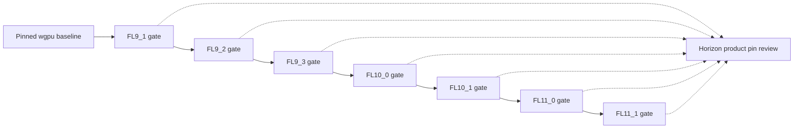
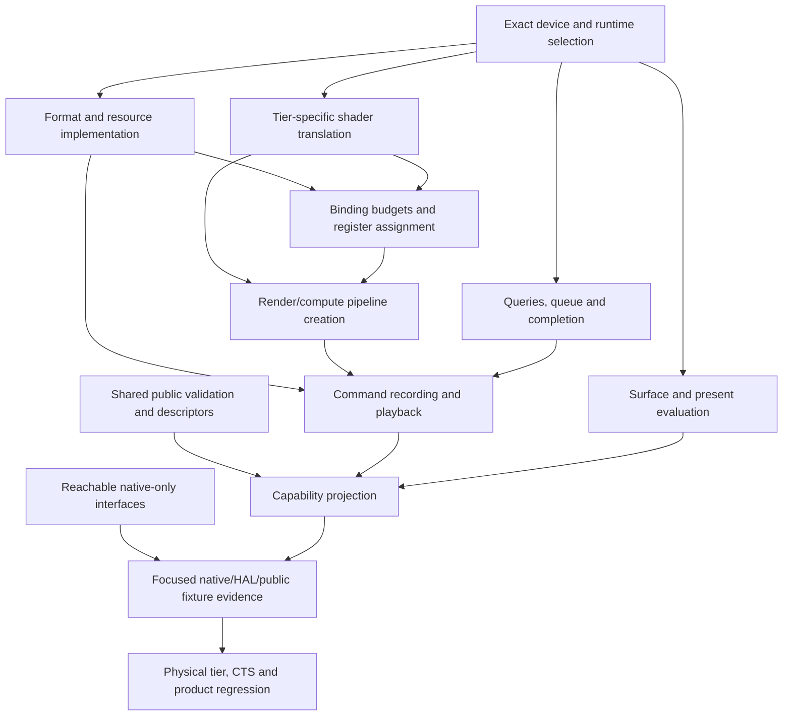

# D3D11 tier dependencies and integration

The integration base is wgpu `aa7b65c43ef008d0a92d20fcdf9f10fa0883f157`. The exact public profile remains the fork’s restricted FL9_1 path even when the driver creates an FL11 device. Enable a higher public profile only after the HAL implementation, public validation and evidence agree. FL9_1 certification and FL9_2 implementation have separate lanes and candidate trees. This roadmap checkout holds the specification and probe research.

## Certification chain

Each gate requires a full candidate SHA, frozen requirement set and linked native, HAL, public and applicable signed device execution. Mission Control owns the gate and records an independent review. Rerun every earlier tier’s required matrix against the same candidate, with explicit feature-level requests. An earlier result from a different SHA can identify the original baseline and help diagnose a regression. Each current result must point to the exact candidate and confirm the actual adapter, negotiated tier and public profile. A reviewed earlier gate is part of the prerequisite chain, and mandatory implementation or hardware evidence outstanding for any tier keeps the candidate **INCOMPLETE**. [Certification protocol](<C:/dev/personal/HorizonCodexCoord-Nov2026/decisions/certification-protocol.md>) · [Integration order](<C:/dev/personal/HorizonCodexCoord-Nov2026/decisions/integration-order.md>)

## Implementation dependencies

A package may include both a backend implementation and its Core checks while default-disabled. Publish a capability only after the reachable resource, validation, command and shader paths have proofs at the advertised boundary. Surface/HDR work contributes only to requirements for which it changes presentation behavior. A native-only API path may use HLSL and a backend-specific surface if approved, but it needs a reachable backend implementation and verified execution. A standalone native probe establishes what the driver does and remains relevant alongside the new path. [Module ownership](../deliverables/dx11-levels/agent-ownership.md) · [Native gap analysis](wgpu-dx11-native-api-gap-analysis.md)

| Promotion | Ordered prerequisites within the tier | Work that can advance before that gate |
| --- | --- | --- |
| FL9_1 | Preserve forced exact FL9_1, audit current exposure and restrictions, then close native gaps and recover exact Lumia/legacy/physical removal coverage. | Recover provenance and classify old fixture and CTS outcomes while the FL9_1 lane runs hardware tests. |
| FL9_2 | Extend strict profile selection and required format/resource handling. Implement native U32 indices, independent color/alpha equations and legal sampler behavior. Wire occlusion command begin/end, availability and aligned resolve into queue lifecycle. Expose only the verified paths. | Develop the default-disabled FL9_2 variant in the assigned worktree, assemble per-format reference data and author boundary fixtures for the native ceiling. |
| FL9_3 | Add FXC 9_3 shader selection and interface validation. Implement legal MRT formats/bit depths and independent masks before promoting attachment count. Verify native indexed instancing and exact 9_3 draw restrictions alongside cube/texture limits. | Develop compiler cases and native HLSL/RTV fixtures. Review planned pipeline and attachment interfaces without editing paths leased to FL9_1/9_2. |
| FL10_0 | Add SM4 render stages and shape/copy support for 1D and arrays. Implement BC4/5, MRT and alpha-to-coverage. Complete reachable geometry and stream-output design and execution. Gate optional DirectCompute 4.x on the actual options bit and representable constraints. | Prototype asset-free standalone GS/stream-output probes. Design the native extension and inventory format usage with the lower tiers untouched. |
| FL10_1 | Use exact SM4.1 targets. Establish cube-array subresource mapping and shader-visible differences. Verify independent blend state, format/sample_count usage and 4× rules before capability elevation. | Run FXC profile comparisons and develop distinct-color blend/MSAA expected-output fixtures. |
| FL11_0 | Complete SM5 profiles, resource bounds, BC6H/7 and MSAA. Land buffer/texture SRV/UAV creation, then common CS/PS register allocation and hazard resolution, then native compute, draw/dispatch indirect and query execution. Complete reachable hull/domain tessellation and inherited GS/SO coverage. | Develop native compute/tessellation HLSL, per-format readback and optional driver query probes in test-only paths. |
| FL11_1 | Capture 11.1 interface and options availability. Extend compute and OM UAV allocation and stage visibility, then execute logic ops, forced rasterization, ranged CB and update/discard/clear/sharing semantics. Verify every changed format property and the earlier fallback. | Build native exact-tier probes for expanded slots, logic ops, forced samples, constant ranges and shared resources. Review API routes for native-only behavior. |

## Integration spine

1. While FL9_1 review is open, Mission Control treats `C:/dev/personal/wgpu-dx11-FL91-cert-Nov21` as the shared D3D11 candidate. The roadmap stays at its research branch. FL9_2 keeps its own base and may stage default-disabled implementation. Further pre-gate packets can use isolated, distinct proposed worktrees when Mission Control confirms ownership and build capacity.
2. After the FL9_1 gate, the integration owner should create or resume a single local `codex/dx11-tier-integration` branch at the accepted SHA, in its own worktree such as `C:/dev/personal/wgpu-dx11-tier-integration-Nov21`. This is a proposed integration spine and path. Coordinate their actual assignment in shared decisions. Import nonoverlapping reviewed patches for the next tier and retain an immutable candidate ref/SHA at each stage.
3. Review higher-tier experiments as disabled code or test-only diffs while earlier promotion gates are pending. Defer edits to common paths leased to the active tier or submit a narrow change request for its owner. When merging work, start from the reviewed lower-tier commit, inspect exact paths and diff against the proposal base, and use a fresh integration worktree or an integration-owner-only worktree. Stop if unrelated changes are present or candidate ancestry cannot be proven.
4. Verify the feature-disabled default and every forced earlier tier first. Then verify the opt-in profile with required native, HAL, public, CTS and device runs. Keep adapter negotiation, runtime queries, backend implementation and public exposure independent in diagnostics. Never let an unsupported, failed or skipped native operation be covered by another backend or by a higher selected feature level.
5. Freeze candidate SHA and evaluation metadata for independent gate review. If rejected, continue in the isolated candidate with an updated SHA and an evidence-gap entry. Keep the previous approved ref available. Product pin changes require their own approved integration and verified candidate archive, build recipe and isolated signed packages. Shared Core, Naga, DXGI and public API changes need impacted DX12/ANGLE regressions because Horizon’s archive overrides those crates workspace-wide. [Renderer overlap and provenance](<C:/dev/personal/HorizonCodexCoord-Nov2026/decisions/renderer-overlap-review.md>)

## Build and device sequencing

Take selection, matrix and source design tasks in parallel. Batch compatible physical cases with the active device owner. Before a GPU run or deployment, acquire the established atomic resource lock and record its owner, session, machine, UTC and action. Use separate target directories outside J:, one expensive Rust release build at a time, and the documented desktop service when remote. Inspect current lock records and machine capacity before assigning time. Use short readiness checks and resume independent CPU/static tasks while a device is unavailable.

For each release candidate, run native strict-level probes first, then targeted public boundary cases, curated tier-specific CTS, and the affected default/prior-tier/higher-backend regressions. Package signed isolated AppContainer tests only after platform architecture and vendor build validation. Schedule Lumia ARM32/CoreWindow and Surface ARM64/SwapChainPanel separately, and verify exact tier results before giving UWP credit. Publish device lock and package identity, raw result and case-level handoff to Mission Control. [Build and device scheduling](<C:/dev/personal/HorizonCodexCoord-Nov2026/decisions/resource-scheduling.md>)
